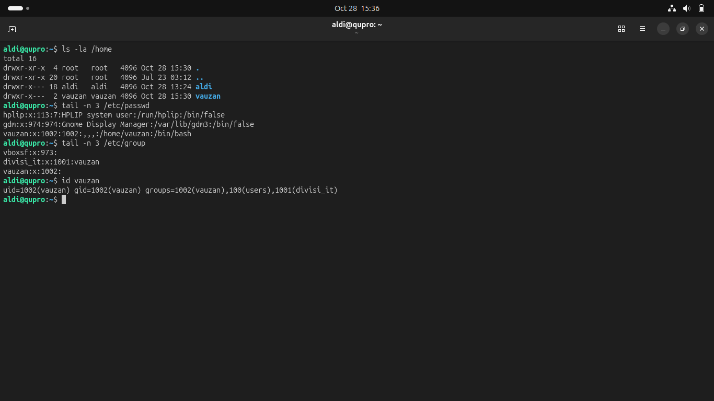
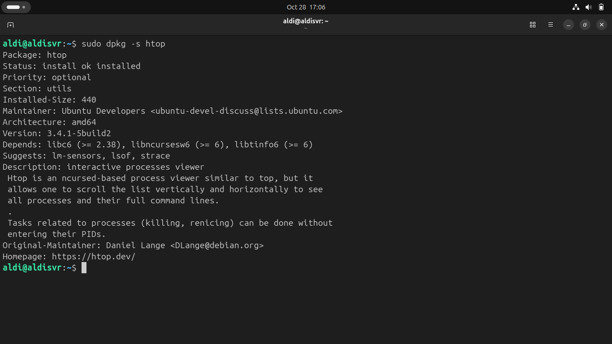
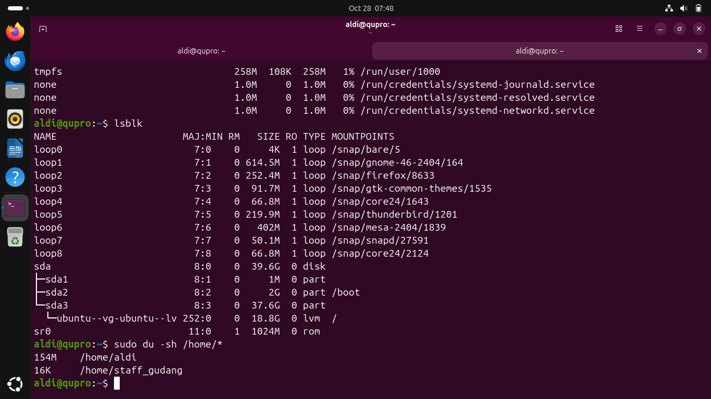
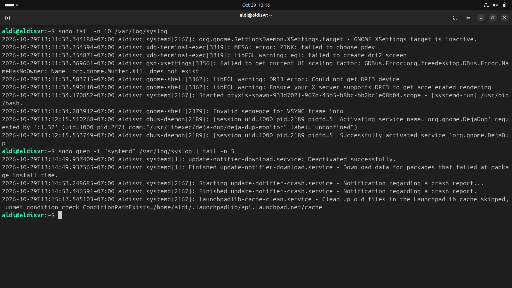
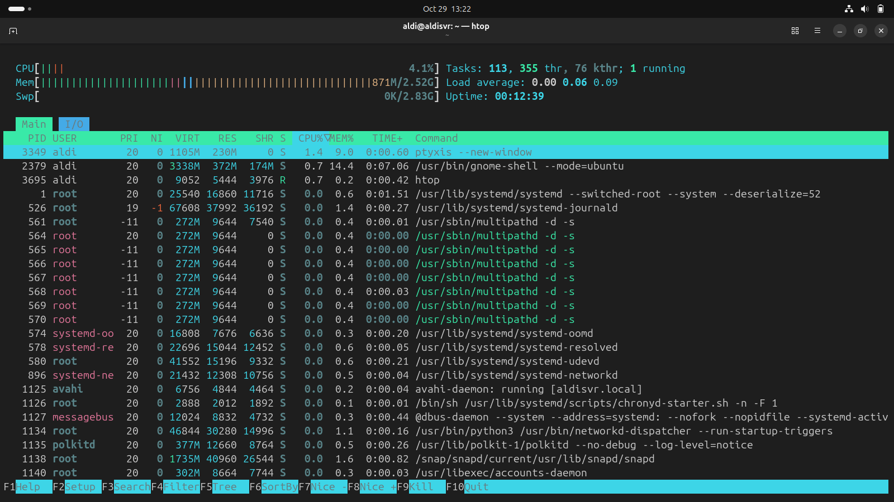
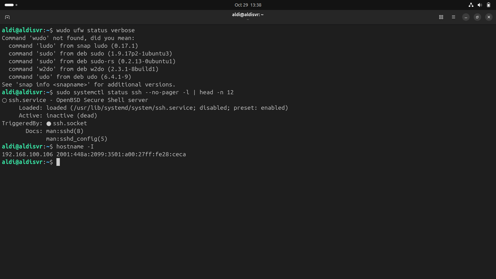
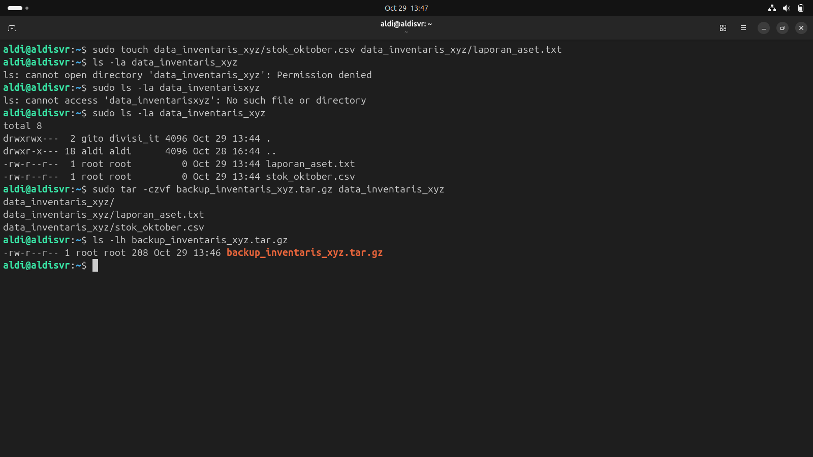

# 🐧 Linux (Ubuntu Server) Administration — Lab Documentation

Repositori ini mendokumentasikan praktik administrasi sistem operasi **Linux** berbasis baris perintah (*Command Line Interface* / CLI) yang mencakup pengelolaan *user/permissions*, pemantauan penyimpanan, analisis *log*, pencadangan data (*backup*), hingga pengamanan akses server.

---

## 1. Manajemen Pengguna, Grup & Hak Akses File (Users & Permissions)
* **Skenario Industri:** Mengatur otorisasi akun staf per divisi dan mengamankan direktori kerja di server agar hanya dapat diakses atau dimodifikasi oleh pengguna yang berwenang.
* **Perintah CLI Utama:**
  * Pembuatan User & Grup: `sudo adduser`, `sudo groupadd`, `sudo usermod -aG`
  * Pengaturan Izin Akses & Kepemilikan: `chmod` (Octal/Symbolic), `chown`, dan verifikasi `ls -la`

> 📸 **Slot Screenshot 1A (User & Group):** Upload gambar dengan nama `linux-users.png`, lalu hapus tanda `<!--` dan `-->` di bawah ini.
> !Manajemen User dan Group Linux!(linux-users.png)

> 📸 **Slot Screenshot 1B (Chmod & Chown Permissions):** Upload gambar dengan nama `linux-permissions.png`, lalu hapus tanda `<!--` dan `-->` di bawah ini.
<!--  -->

---

## 2. Manajemen Paket Aplikasi & Pemantauan Kapasitas Penyimpanan (Disk Monitoring)
* **Skenario Industri:** Memelihara pembaruan perangkat lunak server melalui repositori resmi serta memantau ketersediaan ruang penyimpanan (*disk space*) dan struktur partisi untuk mencegah server berhenti beroperasi akibat penyimpanan penuh.
* **Perintah CLI Utama:**
  * Manajemen Paket: `sudo apt update && sudo apt upgrade`, `sudo apt install`
  * Cek Penyimpanan & Partisi: `df -h`, `du -sh`, `lsblk`

> 📸 **Slot Screenshot 2A (Manajemen Paket APT):** Upload gambar dengan nama `linux-apt.png`, lalu hapus tanda `<!--` dan `-->` di bawah ini.
<!--  -->

> 📸 **Slot Screenshot 2B (Monitoring Disk & Partisi):** Upload gambar dengan nama `linux-disk.png`, lalu hapus tanda `<!--` dan `-->` di bawah ini.
<!--  -->

---

## 3. Investigasi Masalah Sistem Melalui System Logs (`syslog` & Process Management)
* **Skenario Industri:** Melakukan *troubleshooting* layanan server yang mengalami kendala dengan memeriksa catatan sistem (*log files*) secara langsung serta memantau penggunaan sumber daya CPU/RAM.
* **Perintah CLI Utama:**
  * Analisis Log: `cat /var/log/syslog`, `tail -n 20 /var/log/syslog`, `journalctl -xe`, `grep`
  * Manajemen Proses: `top`, `ps aux`, `kill`

> 📸 **Slot Screenshot 3A (Analisis System Log):** Upload gambar dengan nama `linux-syslog.png`, lalu hapus tanda `<!--` dan `-->` di bawah ini.
<!--  -->

> 📸 **Slot Screenshot 3B (Monitoring Proses CPU/RAM):** Upload gambar dengan nama `linux-process.png`, lalu hapus tanda `<!--` dan `-->` di bawah ini.
<!--  -->

---

## 4. Prosedur Backup Data, Remote Access (SSH) & Konfigurasi Firewall (UFW)
* **Skenario Industri:** Mengamankan operasional server melalui kendali jarak jauh terenkripsi (**OpenSSH**), membatasi *port* jaringan yang terbuka menggunakan **Uncomplicated Firewall (UFW)**, serta menjalankan pencadangan (*backup*) direktori penting secara terkompresi.
* **Perintah CLI Utama:**
  * Pengamanan Jaringan & SSH: `sudo ufw allow ssh`, `sudo ufw enable`, `sudo ufw status verbose`, `/etc/ssh/sshd_config`
  * Arsip & Backup Data: `tar -czvf`, `rsync`

> 📸 **Slot Screenshot 4A (Remote SSH & Firewall UFW):** Upload gambar dengan nama `linux-ufw-ssh.png`, lalu hapus tanda `<!--` dan `-->` di bawah ini.
<!--  -->

> 📸 **Slot Screenshot 4B (Backup Arsip dengan TAR):** Upload gambar dengan nama `linux-backup.png`, lalu hapus tanda `<!--` dan `-->` di bawah ini.
<!--  -->
